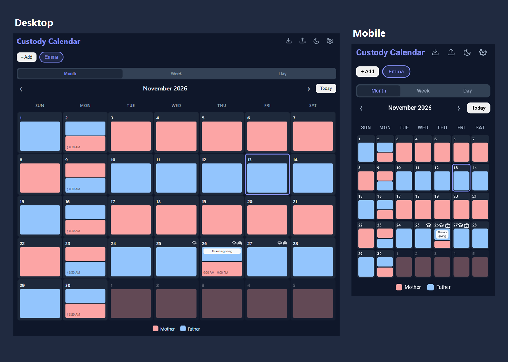

# Custody Calendar

**See parenting time, handoffs, and days off in one calendar.**

Plan a full month at a glance on your phone or computer. Open any date for handoff details, or switch to Week or Day view for a closer look.

[**Open Custody Calendar**](https://cs06.github.io/custody-calendar/)



## Plan around real life

- **See who has the kids.** Give each child their own weekly or alternating rotation and see handoff days in two colors.
- **Make room for exceptions.** Set recurring holidays, alternate holiday assignments by year, or add a one-time swap.
- **Keep track of days off.** Mark school closures, time off work, and vacations on one or more children's calendars without changing custody assignments.
- **Take the calendar with you.** Install it on a supported browser, use it offline after it loads, or print a month and save it as a PDF.

## Get started

1. Open the live calendar and follow the setup wizard to add a child and choose a schedule.
2. Open **Settings** to add holidays, swaps, and days off. **Settings → Help** explains each option.
3. To install, use the browser's install option when available. On iPhone or iPad, open the app in Safari and use **Share → Add to Home Screen**. Export a backup first if you've already entered a schedule. The Home Screen app may use separate storage.

## Your schedule stays in your browser

Use **Export** to download a JSON or PNG backup before clearing browser data or switching devices. Send JSON as a file when sharing through a messaging app, since some apps strip backup data from images. Both formats contain private schedule data.

Use **Import** to restore a backup. **Merge** adds the backup's children as new entries. **Replace all** replaces existing children and their schedules.

<details>
<summary>Run locally and test</summary>

From the project folder, start a local server with Python:

```sh
python -m http.server 8000 --bind 127.0.0.1
```

Open [localhost:8000](http://localhost:8000). With Node.js installed, run the regression checks with:

```sh
node tests/regression.cjs
```

</details>

## License

[Zero-Clause BSD (0BSD)](LICENSE). The bundled meta-png library has a separate [ISC license](LICENSES.md).
